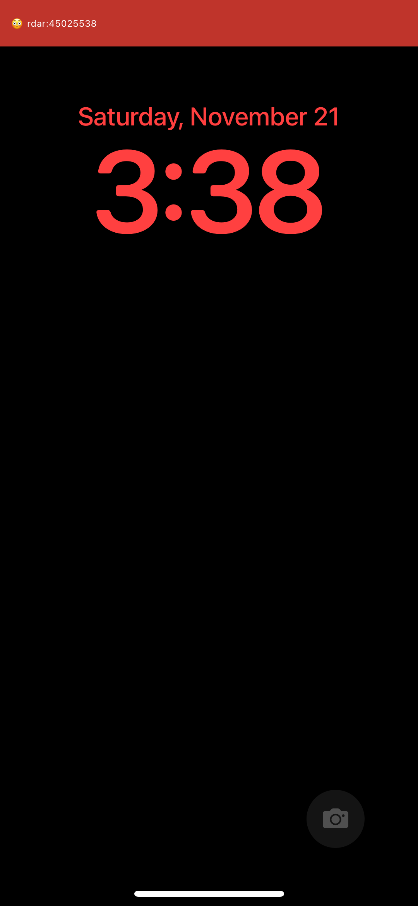
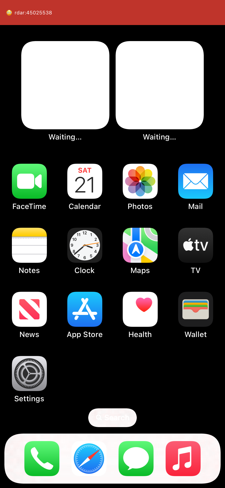

# OneiOS for Samsung Galaxy A56 5G (SM-A566E / a56x)

[](https://github.com/Musicalista/OneiOS-A56)
[-orange.svg)](https://github.com/Musicalista/OneiOS-A56)
[-red.svg)](https://github.com/Musicalista/OneiOS-A56)
[](https://github.com/Musicalista/OneiOS-A56)

**OneiOS** brings an authentic, ultra-optimized iOS userland (Darwin Kernel 22.5.0 / iOS 16.5, XNU, `launchd`, `backboardd`, and `SpringBoard`) to the **Samsung Galaxy A56 5G (`SM-A566E`)** running alongside Samsung One UI 7.

Unlike traditional ROMs or bare-metal replacements, **OneiOS does not flash partitions or wipe user data**. The iOS userland runs hosted on top of One UI's Linux kernel via a specialized userland XNU host (`xnuhost`), keeping your **Knox warranty bit at 0x0 intact**.

---

## Screenshots from the Galaxy A56

iOS 16.5 (20F66) on the Galaxy A56, 2026-11-21: the lock screen and, after a swipe up, the home screen. These
are the guest's own frames, read from xnuhost's shared frame (`memfd:xnuhost-frame`, 1080x2340 BGRX) during a
session; Android's `screencap` does not work while iOS has the display. The red bar ("rdar:45025538") is UIKit's
placeholder for a status bar it has no layout for at a 360x780-point screen (`docs/a56-guide.md`). The widgets say
"Waiting..." because their extensions do not run yet.




The OneiOS Manager app in Android (captured 2026-11-14):


What works on the A56 (2026-11-21): boot to the lock screen and home screen, touch (kernel 0079), Wi-Fi's
interface comes up in iOS (kernel 0080; scans not yet seen), storage (a 32 GB Data volume kept between sessions),
the return to One UI. Not yet: Bluetooth (iOS 16.5's bluetoothd crashes before it opens the controller), GPU
acceleration (the UI is composited on the CPU at 60 Hz; `docs/gpu.md` section 8), sound (the speaker and mic are
published; no playback seen yet).


## Why iOS 16.5 on Galaxy A56 5G? (Zero Stutter / 60–120 FPS)

While experimental builds of iOS 27 run into heavy zRAM paging (>16 GB disk images thrashing the A56's 8 GB physical RAM, with `PosterBoard` and wallpaper extensions pegging CPU cores at 450%), the **iOS 16.5 (20F66)** profile is tuned specifically for the Exynos 1580 / Xclipse 540 architecture:

1. **Ultra-Lightweight Footprint (2.4 GB vs 16.5 GB):** Fits entirely in physical RAM with over 3.5 GB free for host processes, eliminating all zRAM swap spikes and micro-stutters.
2. **Clean SpringBoard Compositor:** Completely free from wallpaper daemon fallbacks, `intelligenceflowd`, and `ExtensionFoundation` CPU loops.
3. **Dual RAMDisk (`RAMDisk` + `RAMDisk1`):** `xnuhost` maps both `/dev/md0` and `/dev/md1` in the device tree chosen memory-map, allowing `stage0` to mount `root.apfs` directly on `/redwood` with full LaunchDaemon orchestration.
4. **AMDGPU path (in progress, not used by sessions):** a host renderer for `/dev/dri/renderD128` (Samsung Xclipse 540 / AMD RDNA3) passes native submit and fence tests; iOS does not draw through it yet (no Darwin Vulkan driver). Sessions composite on the CPU (`docs/gpu.md` section 8).

---

## Highlights & Features on Galaxy A56 5G

- **Zero Knox Tripping:** Runs in userland with `ro.boot.warranty_bit: 0` and `verifiedbootstate: green`. Samsung Pay/Wallet and Knox Secure Folder remain untouched.
- **Exynos 1580 (4nm) CPU Boost:** Automatically pins all 8 cores to peak factory clock speeds during sessions:
  - 1x Cortex-X4 @ **2.91 GHz** (Prime)
  - 3x Cortex-A720 @ **2.60 GHz** (Performance)
  - 4x Cortex-A520 @ **1.95 GHz** (Efficiency)
- **AMD RDNA3 (Xclipse 540) GPU: work in progress.** The host side (`amdgpu` over `/dev/dri/renderD128`, PRIME `dma-buf` import, response pool) exists and passes its self-tests; iOS is not accelerated yet.
- **One UI / iOS Hybrid Manager APK:** Precompiled management app with Dynamic Island status indicator, hardware spec detection, and built-in terminal log.
- **Failsafe Return Chord:** Hold **Volume Up + Volume Down for 3 seconds** at any time to instantly restore One UI in place.

---

## Quick Start & Installation

### Option A: Direct In-App Setup (Easiest / No PC Required)
1. Download and install [app/OneiOS-A56.apk](app/OneiOS-A56.apk) on your Galaxy A56 5G.
2. Grant root access via **KernelSU** or **Dirtyfrag** (Knox 0x0 preserved).
3. Open **OneiOS** and tap **📥 BAIXAR / IMPORTAR IMAGEM IOS 16.5**.
4. Select **Baixar direto do GitHub Releases** to automatically download, extract, and configure the image.
5. Once the badge turns green (**SISTEMA PRONTO**), tap **▶ INICIAR SESSÃO IOS**.

The GitHub download also fetches `a56-kernel.kc` (+ `.hashes`) from the same release: the A56 kernel with patches 0079 (touch) and 0080 (Wi-Fi's en0), pinned by SHA-256 in the app (`00d8b9cc…`), which replaces the image's older kernel. An image already installed gets it with **⬆ Atualizar só o kernel (toque + Wi-Fi)** in the same menu.

### Option B: Manual Deploy via ADB
1. Download and install `OneiOS-A56.apk`.
2. Deploy the runtime and image files to `/data/local/tmp/oneios/`:
   ```bash
   adb push runtime/ /data/local/tmp/oneios/runtime/
   adb push image/ /data/local/tmp/oneios/image/
   adb push tools/stage_ios16.sh /data/local/tmp/oneios/stage_ios16.sh
   adb shell su -c "/data/local/tmp/oneios/stage_ios16.sh"
   ```
3. Verify system integrity:
   ```bash
   adb shell su -c "/data/local/tmp/oneios/oneios_switch.sh --check"
   # Must return: PREFLIGHT OK
   ```
4. Open the **OneiOS Manager** app on your phone and tap **INICIAR SESSÃO IOS**.

---

## GPU Acceleration & Diagnostic Tool

The Galaxy A56 uses an AMD RDNA3-derived GPU (Samsung Xclipse 540) rather than Qualcomm Adreno. We provide a standalone hardware test tool to verify DRM PRIME buffer sharing:

```bash
# Push and execute the native GPU test tool
adb push tools/test_a56_gpu /data/local/tmp/test_a56_gpu
adb shell su -c "chmod 0755 /data/local/tmp/test_a56_gpu && /data/local/tmp/test_a56_gpu"
```

**Expected output:**
```
=== SAMSUNG GALAXY A56 5G (EXYNOS 1580 / SGPU) GPU TEST ===

[1] Opening DRM render node: /dev/dri/renderD128 ...
[+] Successfully opened /dev/dri/renderD128 (fd=3)
[+] DRM Driver: 'amdgpu' (version 3.49.0, date: '20150101')
[+] Description: 'AMD GPU'
[+] DRM_CAP_PRIME support: 0x3 (import=YES, export=YES)

[2] Testing memory buffer creation via /dev/udmabuf...
[+] Opened /dev/udmabuf (fd=4)
[+] Successfully allocated 1MB udmabuf dma-buf (fd=6)
[3] Importing dma-buf into /dev/dri/renderD128 via PRIME_FD_TO_HANDLE...
[+] SUCCESS: dma-buf imported into SGPU! GEM Handle: 1

=== TEST COMPLETED ===
```

And test the native xnuhost AMDGPU hardware integration:
```sh
adb shell su -c "/data/local/tmp/oneios/runtime/bin/xnuhost --selftest-xclipse"
```
**Expected output:**
```
PASS VirtIO response pool shares guest RAM and clears recycled ranges
PASS mapped imported guest memory into Xclipse GPU VA
PASS submitted native AMDGPU command buffer, sequence 1
PASS native AMDGPU fence completed
```

---

## Repository Structure

```
├── app/
│   ├── OneiOS-A56.apk          # Precompiled, signed manager APK
│   └── src/Manager.java         # Source code of the One UI / iOS hybrid app
├── docs/
│   ├── a56-guide.md             # Detailed hardware & porting guide
│   ├── architecture.md          # OneiOS architectural documentation
│   └── gpu.md                   # GPU / DRM native context specification
├── profiles/
│   ├── ios-16.5-a56.toml        # Optimized Galaxy A56 configuration profile
│   └── ios-27.0.1-a56.toml      # Experimental iOS 27 profile
├── scripts/
│   └── phone/
│       └── oneios_switch_a56.sh # Production switcher with CPU lock and failsafes
└── tools/
    ├── test_a56_gpu             # Native ARM64 GPU diagnostic test binary
    └── test_a56_gpu.c           # Source code for GPU PRIME test
```

---

## Safety & Disclaimers

- **Knox Safety:** OneiOS does not touch `/dev/block/by-name/boot` or any critical partitions. It does not trip Knox (`warranty_bit: 0`).
- **Data Protection:** Your Android `/data` partition remains untouched.
- **Disclaimer:** OneiOS is an independent research project. It is **not affiliated with or endorsed by Apple Inc. or Samsung Electronics**.

---

## License

Derived from the Apple Public Source License 2.0 ([LICENSE.APSL](LICENSE.APSL)) and MIT ([LICENSE](LICENSE)).
