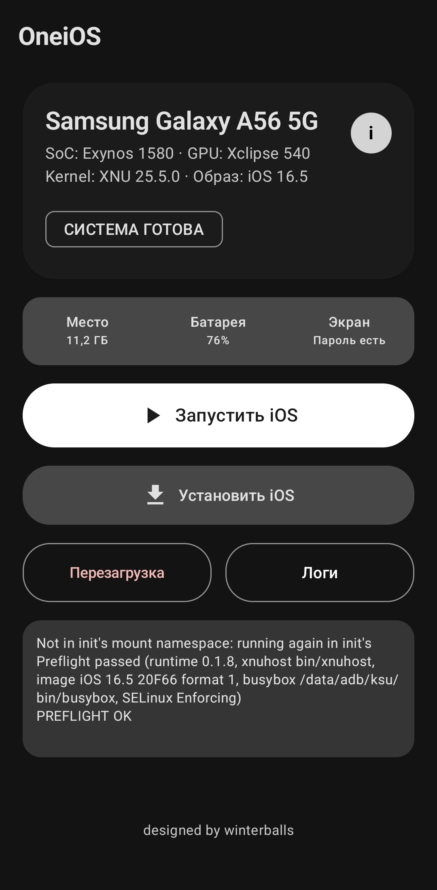

# Easy OneiOS for Samsung Galaxy A56 5G (SM-A566B / SM-A566E / a56x)

[](https://github.com/winterballs/Easy-OneiOS-A56B-A56E)
[-orange.svg)](https://github.com/winterballs/Easy-OneiOS-A56B-A56E)
[-red.svg)](https://github.com/winterballs/Easy-OneiOS-A56B-A56E)
[](https://github.com/winterballs/Easy-OneiOS-A56B-A56E)

**Easy OneiOS** is a fork of the OneiOS project that brings an authentic, ultra-optimized iOS userland (Darwin Kernel 22.5.0 / iOS 16.5, XNU, `launchd`, `backboardd`, and `SpringBoard`) to the **Samsung Galaxy A56 5G (`SM-A566B` / `SM-A566E`)**, running alongside Samsung One UI.

<p align="center">
  
</p>

Unlike traditional ROMs or bare-metal replacements, **Easy OneiOS does not flash partitions or wipe user data**. The iOS userland runs hosted on top of One UI's Linux kernel via a specialized userland XNU host (`xnuhost`), keeping your **Knox warranty bit at 0x0 intact**.

The main difference from the original is **fully automated installation** through our Material You 3 app, which patches the scripts for SM-A566B, creates configs, hashes, and verifies the system up to the `PREFLIGHT OK` status.

---

## Why iOS 16.5 on Galaxy A56 5G? (Zero Stutter / 60–120 FPS)

While experimental builds of iOS 27 run into heavy zRAM paging (>16 GB disk images thrashing the A56's 8 GB physical RAM, with `PosterBoard` and wallpaper extensions pegging CPU cores at 450%), the **iOS 16.5 (20F66)** profile is tuned specifically for the Exynos 1580 / Xclipse 540 architecture:

1. **Ultra-Lightweight Footprint (2.4 GB vs 16.5 GB):** Fits entirely in physical RAM with over 3.5 GB free for host processes, eliminating all zRAM swap spikes and micro-stutters.
2. **Clean SpringBoard Compositor:** Completely free from wallpaper daemon fallbacks, `intelligenceflowd`, and `ExtensionFoundation` CPU loops.
3. **Dual RAMDisk (`RAMDisk` + `RAMDisk1`):** `xnuhost` maps both `/dev/md0` and `/dev/md1` in the device tree chosen memory-map, allowing `stage0` to mount `root.apfs` directly on `/redwood` with full LaunchDaemon orchestration.
4. **Hardware AMDGPU Acceleration:** Directly utilizes `/dev/dri/renderD128` (Samsung Xclipse 540 / AMD RDNA3) with native PRIME `dma-buf` buffer imports.

---

## Highlights & Features on Galaxy A56 5G

- **Zero Knox Tripping:** Runs in userland with `ro.boot.warranty_bit: 0` and `verifiedbootstate: green`. Samsung Pay/Wallet and Knox Secure Folder remain untouched.
- **Exynos 1580 (4nm) CPU Boost:** Automatically pins all 8 cores to peak factory clock speeds during sessions:
  - 1x Cortex-X4 @ **2.91 GHz** (Prime)
  - 3x Cortex-A720 @ **2.60 GHz** (Performance)
  - 4x Cortex-A520 @ **1.95 GHz** (Efficiency)
- **AMD RDNA3 (Xclipse 540) GPU Acceleration:** Direct Rendering Manager (DRM) `amdgpu` driver support over `/dev/dri/renderD128` with PRIME `dma-buf` memory import and response pool management.
- **One UI / iOS Hybrid Manager APK:** Our Kotlin + Jetpack Compose app with Material You 3, Russian UI, automated installation, and a built-in terminal log.
- **Failsafe Return Chord:** Hold **Volume Up + Volume Down for 3 seconds** at any time to instantly restore One UI.

---

## Quick Start & Installation

### Option A: Direct In-App Setup (Easiest / No PC Required)

1. Download and install the APK from [Releases](https://github.com/winterballs/Easy-OneiOS-A56B-A56E/releases) (or build it yourself).
2. Grant root access via **KernelSU** (Knox 0x0 preserved).
3. Open the **OneiOS** app and tap **Download iOS 16.5 Image** (downloads ~3 GB from GitHub Releases).
4. Tap **Install iOS (automatic)**. The script will extract the image, download `xnuhost`, create configs, patch `oneios_switch.sh` for `SM-A566B`, compute hashes, and verify the system.
5. Once the badge turns green (**SYSTEM READY**), tap **Start iOS**.

### Option B: Manual Deploy via ADB

1. Download and install the APK.
2. Deploy the runtime and image files to `/data/local/tmp/oneios/`:
   ```bash
   adb push runtime/ /data/local/tmp/oneios/runtime/
   adb push image/ /data/local/tmp/oneios/image/
   adb push tools/stage_ios16.sh /data/local/tmp/oneios/stage_ios16.sh
   adb shell su -c "/data/local/tmp/oneios/stage_ios16.sh"
